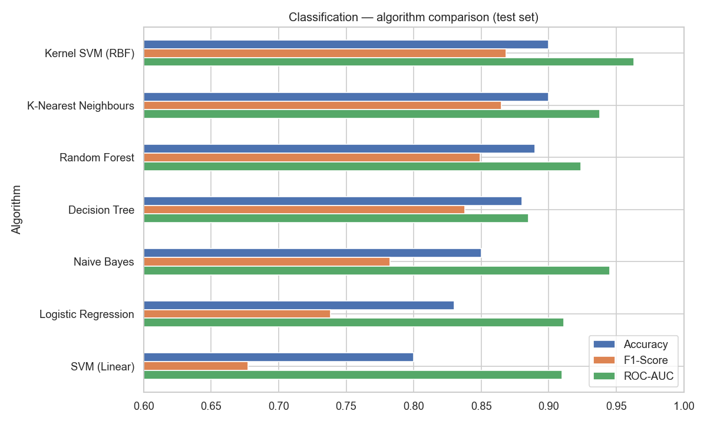
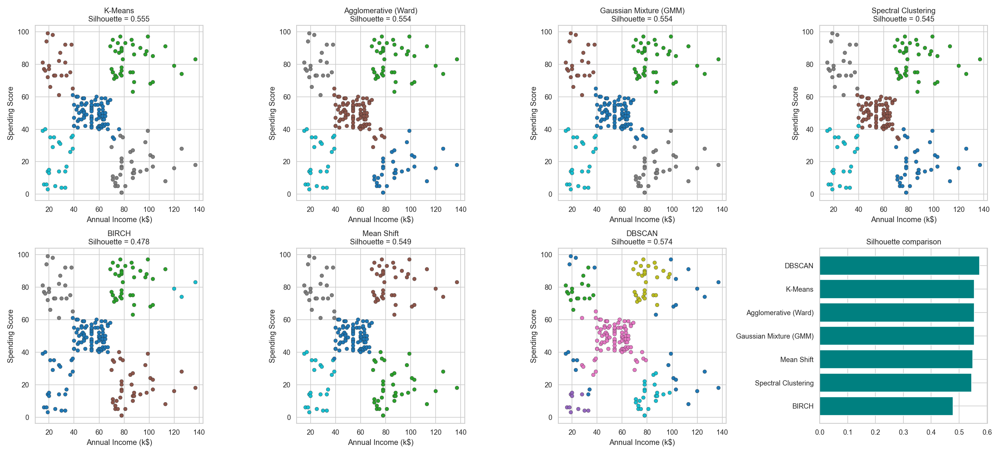
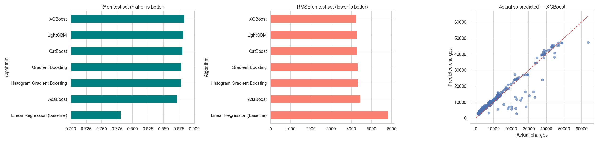

# Machine Learning — Internal Assessment

Three supervised and unsupervised learning tasks, each trained with several algorithms and compared on standard metrics to find the best one.

| # | Task | Dataset | Notebook |
|---|------|---------|----------|
| 1 | **Classification** — will a user buy the product? | `Social_Network_Ads.csv` (400 rows) | [1_Classification_Social_Network_Ads.ipynb](1_Classification_Social_Network_Ads.ipynb) |
| 2 | **Clustering** — customer segmentation | `Mall_Customers.csv` (200 rows) | [2_Clustering_Mall_Customers.ipynb](2_Clustering_Mall_Customers.ipynb) |
| 3 | **Boosting** — predict insurance charges | `insurance_pre.csv` (1,338 rows) | [3_Boosting_Insurance_Charges.ipynb](3_Boosting_Insurance_Charges.ipynb) |

---

## Summary — best algorithm per task

| Task | Best Algorithm | Key Result |
|------|----------------|------------|
| Classification | **Kernel SVM (RBF)** | Accuracy **0.90**, F1 **0.868**, ROC-AUC **0.963** |
| Clustering | **K-Means (k = 5)** | Silhouette **0.555**, Davies-Bouldin **0.572**, Calinski-Harabasz **248.6** |
| Boosting | **XGBoost** | R² **0.884**, MAE **2,441.8**, RMSE **4,243.9** |

---

## 1. Classification — Social Network Ads

Features: Gender, Age, EstimatedSalary → Target: Purchased (0/1). 75/25 stratified split, StandardScaler, 10-fold CV.

| Rank | Algorithm | Accuracy | Precision | Recall | F1-Score | ROC-AUC | CV Accuracy (10-fold) |
|---|---|---|---|---|---|---|---|
| 1 | **Kernel SVM (RBF)** | **0.900** | 0.825 | 0.917 | **0.868** | **0.963** | 0.903 |
| 2 | K-Nearest Neighbours | 0.900 | 0.842 | 0.889 | 0.865 | 0.938 | 0.905 |
| 3 | Random Forest | 0.890 | 0.838 | 0.861 | 0.849 | 0.924 | 0.893 |
| 4 | Decision Tree | 0.880 | 0.816 | 0.861 | 0.838 | 0.885 | 0.875 |
| 5 | Naive Bayes | 0.850 | 0.818 | 0.750 | 0.783 | 0.945 | 0.888 |
| 6 | Logistic Regression | 0.830 | 0.828 | 0.667 | 0.739 | 0.911 | 0.840 |
| 7 | SVM (Linear) | 0.800 | 0.808 | 0.583 | 0.677 | 0.910 | 0.830 |

**Result:** Kernel SVM (RBF) is the best classifier. It ties KNN on accuracy and wins on F1 and ROC-AUC. The purchase boundary in the Age × Salary space is curved, so non-linear models beat linear ones.



## 2. Clustering — Mall Customers

Features: Annual Income (k$), Spending Score (standardised). k = 5 chosen by the elbow method, silhouette analysis and the dendrogram.

| Rank | Algorithm | Clusters | Noise pts | Silhouette ↑ | Davies-Bouldin ↓ | Calinski-Harabasz ↑ |
|---|---|---|---|---|---|---|
| 1 | DBSCAN (eps=0.45, min_samples=10)* | 5 | 29 | 0.574 | 0.483 | 245.1 |
| 2 | **K-Means** | 5 | 0 | **0.555** | 0.572 | **248.6** |
| 3 | Agglomerative (Ward) | 5 | 0 | 0.554 | 0.578 | 244.4 |
| 4 | Gaussian Mixture (GMM) | 5 | 0 | 0.554 | 0.576 | 244.9 |
| 5 | Mean Shift | 5 | 0 | 0.550 | 0.570 | 246.6 |
| 6 | Spectral Clustering | 5 | 0 | 0.545 | 0.586 | 243.8 |
| 7 | BIRCH | 5 | 0 | 0.478 | 0.648 | 144.0 |

\* DBSCAN's scores are computed only on the 171 customers it did not mark as noise. It discards 14.5% of customers, so it is not a like-for-like comparison.

**Result:** K-Means is the best clustering algorithm. It has the highest Silhouette and Calinski-Harabasz scores of all the methods that place every customer in a segment. The five segments it finds:

| Segment | Customers | Avg Income (k$) | Avg Spending Score |
|---|---|---|---|
| Mid income, average spend | 81 | 55.3 | 49.5 |
| High income, high spend | 39 | 86.5 | 82.1 |
| High income, low spend | 35 | 88.2 | 17.1 |
| Low income, low spend | 23 | 26.3 | 20.9 |
| Low income, high spend | 22 | 25.7 | 79.4 |



## 3. Boosting — Insurance Charges (Regression)

Features: age, sex, bmi, children, smoker → Target: charges. 80/20 split. Each model is tuned with GridSearchCV (5-fold) on the training set.

| Rank | Algorithm | R² Score ↑ | MAE ↓ | RMSE ↓ | CV R² (5-fold) ↑ |
|---|---|---|---|---|---|
| 1 | **XGBoost** | **0.8840** | **2441.81** | **4243.94** | 0.8577 |
| 2 | LightGBM | 0.8820 | 2440.54 | 4279.64 | 0.8556 |
| 3 | CatBoost | 0.8810 | 2446.36 | 4297.63 | 0.8573 |
| 4 | Gradient Boosting | 0.8791 | 2476.46 | 4331.56 | 0.8549 |
| 5 | Histogram Gradient Boosting | 0.8787 | 2476.15 | 4340.22 | 0.8572 |
| 6 | AdaBoost | 0.8721 | 2743.21 | 4456.82 | 0.8513 |
| – | Linear Regression (baseline) | 0.7811 | 4213.48 | 5829.17 | 0.7399 |

Best hyper-parameters: XGBoost `learning_rate=0.05, max_depth=3, n_estimators=100` (all models are listed in [results/boosting_best_params.csv](results/boosting_best_params.csv)).

**Result:** XGBoost is the best boosting algorithm, with R² = 0.884 on the test set. Every boosting model beats the linear baseline by about 10 R² points because they capture the smoker × BMI and smoker × age interactions. `smoker` is the strongest predictor.



---

## How to run

```bash
pip install -r requirements.txt
jupyter notebook
```

Run any notebook top to bottom. Result tables (CSV) and plots are saved to `results/`.

## Project structure

```
├── data/                  # the three datasets
├── results/               # result tables (.csv) and plots (.png)
├── 1_Classification_Social_Network_Ads.ipynb
├── 2_Clustering_Mall_Customers.ipynb
├── 3_Boosting_Insurance_Charges.ipynb
├── requirements.txt
└── README.md
```
