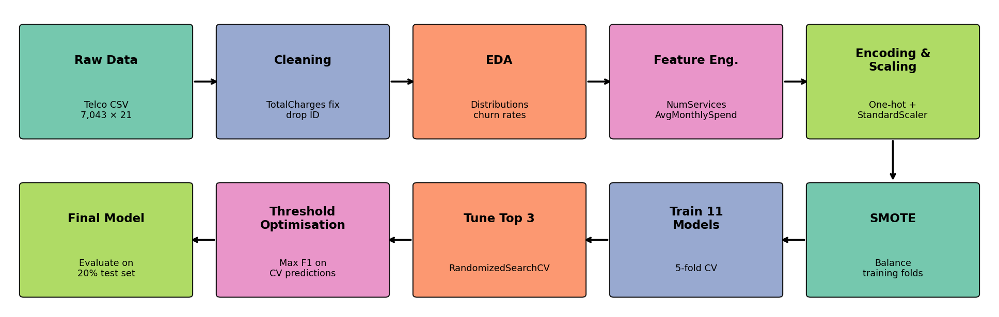
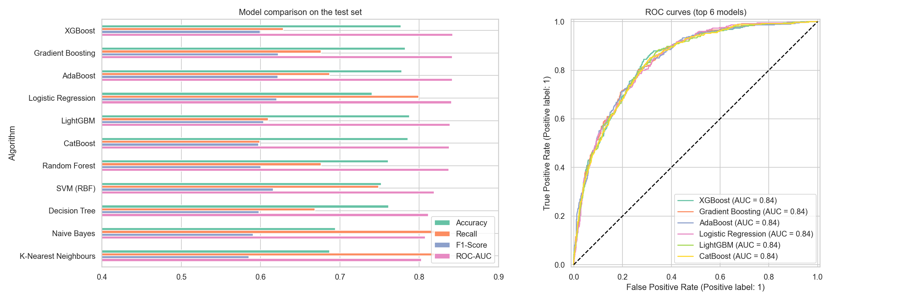
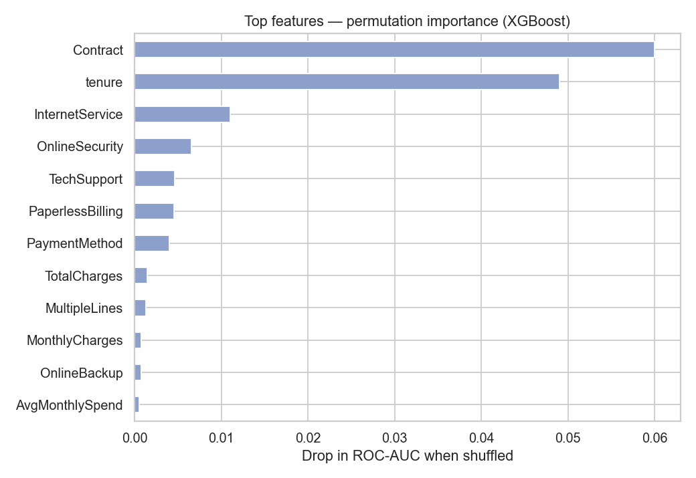

# Customer Churn Prediction using Machine Learning

**Mini Project — Machine Learning Internal Assessment** (batch of 3)

Predicts which telecom customers are about to leave (churn), so the business can target them with retention offers before they go.

- **Dataset:** [Telco Customer Churn — Kaggle](https://www.kaggle.com/datasets/blastchar/telco-customer-churn): 7,043 customers × 21 attributes, 26.5 % churn
- **Notebook:** [Customer_Churn_Prediction.ipynb](Customer_Churn_Prediction.ipynb)
- **Report:** [report/Mini_Project_Report_Customer_Churn.pdf](report/Mini_Project_Report_Customer_Churn.pdf)

## Pipeline
Data cleaning → EDA → feature engineering (`NumServices`, `AvgMonthlySpend`) → one-hot encoding + scaling → **SMOTE inside the CV pipeline** (no leakage) → 11 algorithms compared → top 3 tuned with RandomizedSearchCV → decision-threshold optimisation → permutation feature importance → saved model.



## Results — all algorithms (20 % held-out test set)

| Rank | Algorithm | Accuracy | Precision | Recall | F1-Score | ROC-AUC | CV ROC-AUC |
|---|---|---|---|---|---|---|---|
| 1 | **XGBoost** | 0.7771 | 0.5732 | 0.6283 | 0.5995 | **0.8420** | 0.8417 |
| 2 | Gradient Boosting | 0.7821 | 0.5763 | 0.6765 | 0.6224 | 0.8417 | 0.8450 |
| 3 | AdaBoost | 0.7779 | 0.5673 | 0.6872 | 0.6215 | 0.8415 | 0.8451 |
| 4 | Logistic Regression | 0.7402 | 0.5068 | 0.7995 | 0.6203 | 0.8405 | 0.8447 |
| 5 | LightGBM | 0.7878 | 0.5984 | 0.6096 | 0.6040 | 0.8386 | 0.8378 |
| 6 | CatBoost | 0.7857 | 0.5957 | 0.5989 | 0.5973 | 0.8380 | 0.8397 |
| 7 | Random Forest | 0.7608 | 0.5394 | 0.6765 | 0.6002 | 0.8371 | 0.8405 |
| 8 | SVM (RBF) | 0.7523 | 0.5234 | 0.7487 | 0.6161 | 0.8186 | 0.8266 |
| 9 | Decision Tree | 0.7615 | 0.5411 | 0.6684 | 0.5981 | 0.8113 | 0.8165 |
| 10 | Naive Bayes | 0.6941 | 0.4580 | 0.8316 | 0.5907 | 0.8074 | 0.8217 |
| 11 | K-Nearest Neighbours | 0.6870 | 0.4514 | 0.8316 | 0.5851 | 0.8028 | 0.8100 |

## Final model — tuned XGBoost

| Setting | Accuracy | Precision | Recall | F1-Score | ROC-AUC |
|---|---|---|---|---|---|
| Threshold 0.50 | 0.7807 | 0.5708 | 0.7005 | 0.6291 | 0.8437 |
| **Threshold 0.44 (optimised)** | 0.7672 | 0.5447 | **0.7487** | **0.6306** | **0.8437** |

The final model catches **280 of 374 churners (74.9 %)** in the unseen test set.



## Key drivers of churn
| Factor | Churn rate |
|---|---|
| Month-to-month contract vs two-year | 42.7 % vs 2.8 % |
| Fibre-optic internet vs DSL | 41.9 % vs 19.0 % |
| Electronic check vs auto credit card | 45.3 % vs 15.2 % |
| No Online Security vs with it | 41.8 % vs 14.6 % |
| Senior citizen vs not | 41.7 % vs 23.6 % |



## Run it
```bash
pip install -r requirements.txt
jupyter notebook Customer_Churn_Prediction.ipynb
```
The trained model is saved at `model/churn_model.joblib` as `{'model': pipeline, 'threshold': 0.44}`. It takes a customer row with the dataset's columns plus the two engineered features `NumServices` and `AvgMonthlySpend` (see notebook section 3), and returns a churn probability.

## Team
| Name | Register No. |
|---|---|
| Abhinav Tiwari | — |
| — | — |
| — | — |
